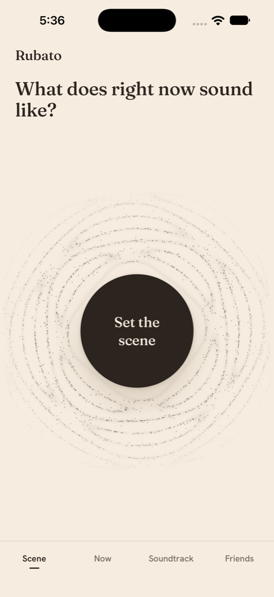
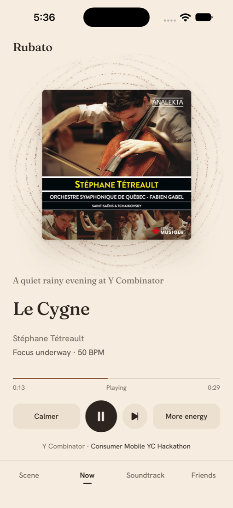
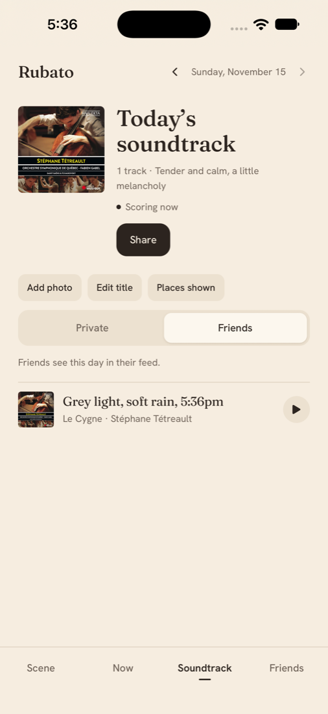
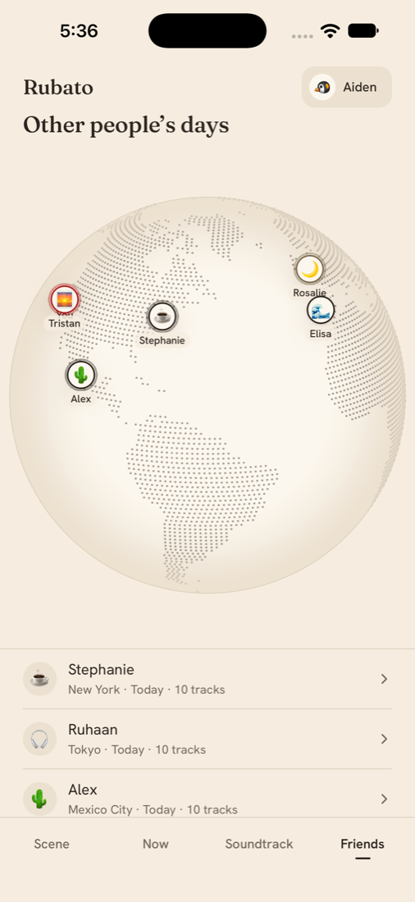

# Rubato

**A soundtrack for whatever you're doing right now.** Rubato reads where you are, the weather, the time, what's on your calendar and how fast you're moving, then plays the song that fits the moment. Every song is kept, so your day becomes a soundtrack you can share.

**Try it:** [rubato.expo.app](https://rubato.expo.app) (web version; on a phone, add it to your home screen)

Built at the YC Consumer Mobile Hackathon, November 2026.

<p align="center">
  
  
  
  
</p>

## What it does

- **Scene.** One button: *Set the scene*. Rubato reads the moment step by step and writes it out ("You're at Y Combinator, in San Francisco. Rain is falling, and it's sixty degrees…"), then picks your first song.
- **Now.** The song playing, why it was picked, and a figure of fine grains around the cover that takes its colour from the album art and its shape from the song. Pause, skip, or ask for something calmer or more energetic. When your moment changes, the music follows.
- **Soundtrack.** Every song you heard today, each titled for where and when it played ("Rain on 20th Street, 5:36pm"). Add photos, name the day, and share it as a poster.
- **Friends.** A globe showing where your friends are. Tap one to fly there and play through their day.

## How it works

```
phone or browser ──▶ Convex action (next:pick) ──▶ one song + a fresh preview URL
   place, weather,        scene → candidates by tempo →
   time, calendar, pace   rank by fit → pick from the top few
```

1. **Sense.** The app gathers place (GPS, named through OpenStreetMap), weather, the clock, the next calendar event and step cadence. Each signal uses the real source when the device has one, and a demo scenario when it doesn't.
2. **Build the scene.** Pace, weather, time of day and setting reduce to a target energy, mood and tempo. The same code runs in the app and on the backend, so they always agree (`convex/lib/scene.ts`).
3. **Match.** Songs whose tempo fits your pace (half and double time count) are scored on energy, mood and how well their labels fit the scene, using precomputed embeddings. No model runs at request time; a pick takes about a quarter of a second.
4. **Play and log.** Thirty-second previews crossfade from one pick to the next, and each one is logged into the day's soundtrack.

Every tuning number lives in one file: `convex/tuning.ts`.

## Stack

| Part | Built with |
| --- | --- |
| App | Expo SDK 58, React Native, TypeScript, Expo Router |
| Graphics | Skia on iOS and Android, canvas on web, Reanimated |
| Backend and database | Convex (functions, tables, vector index, cron) |
| Song library | 1,929 songs, labelled offline by an LLM, with tempo measured from audio |
| Builds and device checks | Revyl (cloud builds, iOS and Android cloud devices) |
| Web hosting | EAS Hosting |

The look (warm paper, dark ink, Fraunces and Hanken Grotesk, colour only from album art) is specified in `05-visual-identity.md`.

## Run it

```sh
npm install
```

You need a Convex deployment for the backend: `npx convex dev` creates one and writes its address to `.env.local`.

**In a browser** (fastest):

```sh
npx expo start --web
```

Open the printed address and narrow the window to phone width.

**On a phone with Expo Go:**

```sh
npx expo start --go
```

Scan the QR code. The phone and computer must be on a network that lets them reach each other; many office and guest networks do not. This route has not yet been verified on a device.

**As a native build on a cloud device** (needs a [Revyl](https://revyl.com) account):

```sh
revyl build --profile preview --platform ios --remote      # or android
revyl device start --platform ios --app-id <app id> --open
```

`revyl device start` uses the newest build for your current git branch, so build after you change code. Stop devices when you are done (`revyl device stop --all`): builds and devices share the organisation's slots.

**Publish the web version:**

```sh
npx expo export --platform web
npx eas-cli deploy --prod
```

## Demo data

Simulators, cloud devices and browsers have no step counter or calendar, so there the app uses a built-in scenario: Y Combinator's San Francisco office, rain at 60°F, and a calendar event called "Consumer Mobile YC Hackathon". On a real phone it uses real signals.

A long press on *Set the scene* opens a hidden sheet for choosing another scenario (5th Avenue, Golden Gate Park, Shibuya at night, the gym, at home), searching for a place, or switching to real signals.

The six friends on the globe are seeded and add to their soundtracks through the day.

## Project layout

```
src/app/            screens (Expo Router): Scene, Now, Soundtrack, Friends
src/components/     UI: the kit in ui/, the cymatic figure, the globe
src/lib/            the engine: sensing, setup sequence, audio crossfade, session, replay
src/theme/          design tokens
convex/             backend: schema, picking, plays, soundtrack, feed, places, weather, seeding
convex/tuning.ts    every weight and threshold
shared/vocab.json   mood and scene vocabulary shared by the app and the pipeline
pipeline/           Python scripts that build the song library (see pipeline/README.md)
scripts/            backend smoke test and checks
.revyl/config.yaml  build recipes and pull-request checks
```

## Checks

```sh
npx tsc --noEmit
npx expo lint
npx expo-doctor
node scripts/smoke-next.mjs      # picks, logging and the soundtrack against your Convex deployment
```

## Status and limits

This is a hackathon prototype.

- **Verified:** the full flow on the web build and on an iOS cloud simulator. Android builds pass, and an earlier version was checked on an Android cloud emulator.
- **Not yet verified on a real phone:** live step sensing, GPS, the calendar, and the permission prompts. The code paths exist and are covered by tests against fakes.
- **Playback is foreground only.** Locking the phone stops the music.
- **Previews, weather and place names come from free, rate-limited services** (iTunes Search, Open-Meteo and MET Norway, OpenStreetMap and Photon). Fine for a demo, not for a crowd.
- **No accounts.** A device ID identifies you.
- **One backend.** Everything runs against a development Convex deployment.

`PLAN.md` has the original build plan and how it changed.

## Credits

- Song previews from the iTunes Search API; cover art and catalogue data from Deezer.
- Weather from Open-Meteo and MET Norway.
- Place names from OpenStreetMap contributors (Nominatim and Photon).
- Globe land shapes from Natural Earth.
- Fonts: Fraunces and Hanken Grotesk.
